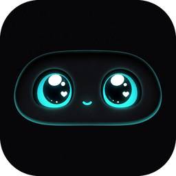
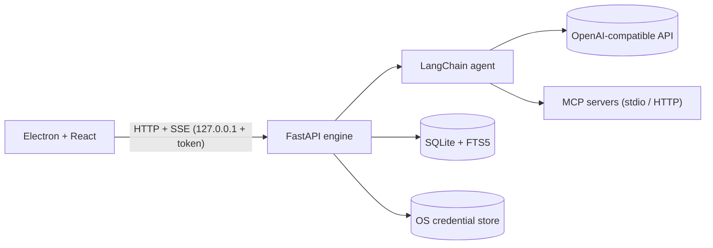

<div align="center">



# Vision · ویژن

**دستیار هوش مصنوعی دسکتاپ، کاملاً محلی · A fully local desktop AI assistant**

[](https://github.com/Sam-Khandnai/Vision_Desktop/releases/latest)
[](https://github.com/Sam-Khandnai/Vision_Desktop/actions)

**[فارسی](#fa)** · **[English](#en)**

</div>

---

<a name="fa"></a>

<div dir="rtl">

# 🇮🇷 فارسی

**Vision** یک دستیار هوش مصنوعی روی رایانه‌ی خودته. به هر مدل سازگار با OpenAI و هر سرور MCP وصل می‌شه، چت‌ها و حافظه‌ش فقط روی همین سیستم می‌مونن، و فقط برای حرف زدن با API مدل و سرورهای MCP به اینترنت وصل می‌شه.

## ✨ امکانات

- **هر مدل، هر ارائه‌دهنده:** هر سرویس سازگار با OpenAI (OpenAI، OpenRouter، Groq، DeepSeek، Together، Ollama محلی و…) با دریافت خودکار لیست مدل‌ها و تست اتصال.
- **مدل‌های محلی:** با سرویس Ollama روی همین سیستم کار کن؛ کافیه «مدل محلی» رو روشن کنی، نیازی به کلید API نیست و مدل‌ها خودکار از `http://localhost:11434/v1` خونده می‌شن.
- **بیش از ۹۰ سرور MCP آماده:** کاتالوگ دوزبانه در ۱۱ دسته (فایل، وب، برنامه‌نویسی، دیتابیس، ارتباطات، مالی و…). برای هر کدوم فرم اتصال با همون اطلاعات لازم (پوشه، کلید، توکن) و برچسب سطح خطر داره.
- **تأیید پیش از اجرا:** ابزارهایی که ممکنه چیزی رو تغییر بدن (نوشتن، حذف، ارسال…) قبل از اجرا از تو اجازه می‌گیرن. برای هر سرور می‌تونی «هوشمند»، «همیشه بپرس» یا «هرگز نپرس» رو انتخاب کنی.
- **حافظه‌ی سه‌لایه:** پیام‌های اخیر، خلاصه‌ی خودکار گفتگوهای بلند، و نکته‌های ماندگار درباره‌ی تو که با جستجوی سریع (FTS5) بازیابی می‌شن. هر مورد رو می‌تونی ببینی، حذف کنی یا کل حافظه رو خاموش کنی.
- **شخصی‌سازی:** اسم، «درباره‌ی من» و سبک پاسخ‌دادن که در همه‌ی گفتگوها به دستیار داده می‌شه.
- **تجربه‌ی چت کامل:** پاسخ استریم، رندر Markdown و کد با دکمه‌ی کپی، کارت قابل‌بازشدن برای هر ابزار، دکمه‌ی توقف که پاسخ ناقص رو نگه می‌داره، تاریخچه‌ی قابل‌جستجو.
- **دوزبانه:** رابط فارسی و انگلیسی با تشخیص زبان سیستم.
- **آپدیت خودکار:** برنامه‌ی نصب‌شده نسخه‌های جدید رو از GitHub Releases پیدا می‌کنه و نصب می‌کنه.
- **ماسکوت Vision:** چهره‌ای که حالتش با وضعیت برنامه عوض می‌شه (فکر می‌کنه، تایپ می‌کنه، منتظر تأیید توئه، خطا رو می‌فهمه).

## 📥 نصب (ویندوز)

1. از **[Releases](https://github.com/Sam-Khandnai/Vision_Desktop/releases/latest)** فایل `Vision-Setup-x.y.z.exe` رو دانلود کن و اجرا کن.
2. اگه ویندوز هشدار SmartScreen داد («ناشناس»)، روی **More info** و بعد **Run anyway** بزن. اینستالر هنوز امضای دیجیتال نداره.
3. برنامه رو باز کن. بار اول مستقیم تنظیمات مدل باز می‌شه.

اینستالر موتور برنامه، `uv` و Node.js رو همراه خودش داره؛ پس لازم نیست پایتون یا Node نصب کنی. سرورهای MCP بار اول، بسته‌های خودشون رو از اینترنت می‌گیرن و ممکنه چند دقیقه طول بکشه.

## 🚀 شروع سریع

1. **تنظیمات ← مدل و API ← افزودن مدل.** یکی از پیش‌تنظیم‌ها (مثل OpenRouter) رو بزن، کلید API رو بذار، **دریافت لیست** رو بزن و مدل رو انتخاب کن. بعد **تست اتصال** و **ذخیره**.
   برای مدل محلی: پیش‌تنظیم **Ollama** رو بزن (گزینه‌ی «مدل محلی» خودکار روشن می‌شه، کلید API نمی‌خواد)، **دریافت لیست** رو بزن و مدل رو انتخاب کن. Ollama باید روی سیستمت در حال اجرا باشه.
2. **کاتالوگ MCP** (از سایدبار یا تب MCP): یک سرور مثل Filesystem رو انتخاب کن، پوشه‌ی مجاز رو بده و **افزودن** رو بزن. وضعیتش (متصل یا خطا) توی تنظیمات ← MCP دیده می‌شه.
3. توی صفحه‌ی چت بنویس: «پوشه‌ی پروژه‌ام رو بررسی کن». دستیار ابزار رو صدا می‌زنه و اگه کاری تغییردهنده باشه اول ازت می‌پرسه.

## 🔒 حریم خصوصی و امنیت

- چت‌ها، حافظه و تنظیمات روی همین رایانه ذخیره می‌شن: `%APPDATA%\Vision\data` (پایگاه‌داده‌ی SQLite).
- **کلیدهای API و رمزهای MCP** توی Credential Manager ویندوز نگه‌داری می‌شن، نه در پایگاه‌داده.
- موتور فقط روی `127.0.0.1` و پورت تصادفی گوش می‌ده و هر درخواست باید توکن تصادفی همون اجرا رو داشته باشه.
- هر سرور MCP به منابعی که بهش می‌دی دسترسی داره. فقط به سرورهایی که اعتماد داری وصل شو و برای سرورهای «دسترسی بالا» تأیید رو روشن نگه دار.
- حذف برنامه، داده‌ها رو پاک نمی‌کنه. برای پاک‌سازی کامل، پوشه‌ی `%APPDATA%\Vision` و ورودی‌های Vision در Credential Manager رو هم حذف کن.

## 🏗️ معماری



```
src/vision/    موتور پایتون: main.py (FastAPI)، chat.py، providers.py، mcp_hub.py،
               approvals.py، memory.py، db.py، secrets_store.py، catalog.py + data/mcp_catalog.json
desktop/       برنامه‌ی Electron + React
tests/         تست‌های بک‌اند (سرور MCP واقعی، استریم، تأیید، مهاجرت دیتابیس)
scripts/       build_catalog.py، check_catalog.py، probe_catalog.py، build_installer.py، bump_version.py
.github/       گردش‌کار انتشار خودکار
```

## 🛠️ توسعه

پیش‌نیاز: [uv](https://docs.astral.sh/uv/) و Node.js ۲۰ یا بالاتر.

```bash
uv sync
cd desktop
npm install
npm run dev
```

تست‌ها:

```bash
uv run pytest                           # بک‌اند
cd desktop && npm test                  # رابط (بک‌اند واقعی + مدل ساختگی)
node check-i18n.mjs                     # کامل بودن ترجمه‌ها
uv run python scripts/check_catalog.py  # وجود پکیج‌ها و نام متغیرهای کاتالوگ در npm/PyPI
uv run python scripts/probe_catalog.py  # هر سرور محلی کاتالوگ را واقعاً اجرا می‌کند
```

سرورهایی که کلید یا برنامه‌ی واقعی می‌خوان (دیتابیس‌ها، Docker، OAuth گوگل…) در `probe_catalog` با مقدار نمونه خطا می‌دن؛ این طبیعیه.

### افزودن سرور به کاتالوگ

`scripts/build_catalog.py` رو ویرایش کن (یک `add(...)` با متن فارسی و انگلیسی)، بعد:

```bash
uv run python scripts/build_catalog.py
uv run python scripts/check_catalog.py
uv run python scripts/probe_catalog.py <id>
```

راز و کلید همیشه باید `env` یا `header` باشن، هرگز آرگومان خط فرمان؛ تست کاتالوگ همین رو چک می‌کنه.

### تغییر ساختار دیتابیس

`SCHEMA` و ورودی‌های قدیمی `MIGRATIONS` در `src/vision/db.py` رو هیچ‌وقت ویرایش نکن. فقط یک `(شماره, "SQL")` به آخر `MIGRATIONS` اضافه کن. قبل از هر مهاجرت یک نسخه‌ی پشتیبان (۵ تای آخر) در `data\backups` ذخیره می‌شه و اگه مهاجرتی خطا بده، برنامه متوقف می‌شه و داده خراب نمی‌شه.

## 📦 ساخت اینستالر و انتشار

ساخت اینستالر برای سیستم‌عاملی که روش هستی:

```bash
uv run python scripts/build_installer.py           # اینستالر کامل ← desktop/release
uv run python scripts/build_installer.py --dir     # فقط برنامه‌ی باز‌شده، برای تست سریع
uv run python scripts/build_installer.py --no-node # بدون Node.js، کوچک‌تر
```

انتشار نسخه‌ی جدید (کاربران نصب‌شده خودکار آپدیت می‌شن):

```bash
uv run python scripts/bump_version.py 0.2.0
git add -A && git commit -m "Release 0.2.0" && git tag v0.2.0 && git push && git push --tags
```

پوش تگ `v*` گردش‌کار GitHub Actions رو اجرا می‌کنه که اینستالر ویندوز رو می‌سازه و به‌عنوان Release منتشر می‌کنه. تگ باید با نسخه‌ی `desktop/package.json` یکی باشه. ریپو باید عمومی باشه تا آپدیت بدون توکن کار کنه.

## 🩺 عیب‌یابی

| مشکل | چیکار کنم |
|---|---|
| برنامه باز می‌شه ولی موتور بالا نمیاد | فایل `%APPDATA%\Vision\logs\backend.log` رو ببین. |
| سرور MCP «خطا» نشون می‌ده | پیام خطا زیر اسم سرور در تنظیمات ← MCP نوشته شده. بار اول دانلود بسته تا ۲ دقیقه طول می‌کشه. |
| آپدیت نمیاد | `%APPDATA%\Vision\logs\updater.log` رو ببین. |
| ویندوز نصب رو بلاک می‌کنه | SmartScreen: **More info ← Run anyway**. |

## 📌 وضعیت و محدودیت‌ها

- اینستالر ویندوز موجوده. اسکریپت ساخت برای macOS و Linux هم نوشته شده ولی روی اون سیستم‌ها هنوز تست یا منتشر نشده.
- اینستالر امضای دیجیتال نداره (هشدار SmartScreen).
- برخی سرورهای MCP کاتالوگ به کلید یا برنامه‌ی دیگه‌ای نیاز دارن (توضیحش توی فرم هر سرور هست) و همه‌شون روی هر سیستمی تست نشدن.
- دکمه‌ی دستی «بررسی بروزرسانی» هنوز نیست؛ چک خودکار انجام می‌شه.

</div>

---

<a name="en"></a>

# 🇬🇧 English

**Vision** is an AI assistant that lives on your own computer. It connects to any OpenAI-compatible model and any MCP server, keeps your chats and memory on this machine, and only goes online to talk to the model API and the MCP servers you choose.

## ✨ Features

- **Any model, any provider:** every OpenAI-compatible service (OpenAI, OpenRouter, Groq, DeepSeek, Together, local Ollama, …) with automatic model listing and a connection test.
- **Local models:** run against Ollama on your own machine — turn on *Local model*, no API key needed, and models are listed automatically from `http://localhost:11434/v1`.
- **90+ ready MCP servers:** a bilingual catalog in 11 categories (files, web, development, databases, communication, finance, …). Each entry has a connection form asking only for what it needs (folder, key, token) and a risk label.
- **Approval before action:** tools that may change something (write, delete, send, …) ask for your permission first. Per server you choose *Smart*, *Always ask* or *Never ask*.
- **Three-layer memory:** recent messages, an automatic rolling summary for long chats, and durable facts about you retrieved with fast full-text search (FTS5). You can inspect and delete each item, or switch memory off entirely.
- **Personalization:** your name, "about me" and preferred answer style are given to the assistant in every chat.
- **A complete chat experience:** streaming answers, Markdown and code with copy buttons, expandable cards for every tool call, a Stop button that keeps the partial answer, searchable history.
- **Bilingual:** Persian and English interface, detected from your system language.
- **Auto-update:** the installed app finds new versions on GitHub Releases and installs them.
- **The Vision mascot:** a face whose mood follows what the app is doing (thinking, typing, waiting for your approval, understanding an error).

## 📥 Install (Windows)

1. Download `Vision-Setup-x.y.z.exe` from **[Releases](https://github.com/Sam-Khandnai/Vision_Desktop/releases/latest)** and run it.
2. If Windows shows a SmartScreen warning ("unknown publisher"), click **More info → Run anyway**. The installer is not code-signed yet.
3. Open the app. On first launch it opens the model settings for you.

The installer bundles the engine, `uv` and Node.js, so you do not need Python or Node installed. MCP servers download their own packages on first use, which can take a few minutes.

## 🚀 Quick start

1. **Settings → Model & API → Add model.** Pick a preset (e.g. OpenRouter), paste your API key, press **Fetch list**, choose a model, then **Test connection** and **Save**.
   For a local model: pick the **Ollama** preset (the *Local model* switch turns on by itself, no API key needed), press **Fetch list** and choose a model. Ollama must be running on your machine.
2. **MCP catalog** (sidebar or the MCP tab): pick a server such as Filesystem, give it an allowed folder and press **Add**. Its status (connected or error) shows in Settings → MCP.
3. In the chat, write: "Inspect my project folder". The assistant calls the tool, and asks first if the action would change something.

## 🔒 Privacy & security

- Chats, memory and settings are stored on this computer: `%APPDATA%\Vision\data` (a SQLite database).
- **API keys and MCP secrets** live in the Windows Credential Manager, never in the database.
- The engine listens only on `127.0.0.1` on a random port, and every request must carry that launch's random token.
- An MCP server can reach every resource you give it. Connect only servers you trust, and keep approval on for "high access" ones.
- Uninstalling does not delete your data. For a full wipe, also remove `%APPDATA%\Vision` and the Vision entries in Credential Manager.

## 🏗️ Architecture


```
src/vision/    Python engine: main.py (FastAPI), chat.py, providers.py, mcp_hub.py,
               approvals.py, memory.py, db.py, secrets_store.py, catalog.py + data/mcp_catalog.json
desktop/       Electron + React app
tests/         backend tests (real MCP server, streaming, approvals, database migrations)
scripts/       build_catalog.py, check_catalog.py, probe_catalog.py, build_installer.py, bump_version.py
.github/       automated release workflow
```

## 🛠️ Development

Requirements: [uv](https://docs.astral.sh/uv/) and Node.js 20+.

```bash
uv sync
cd desktop
npm install
npm run dev
```

Tests:

```bash
uv run pytest                           # backend
cd desktop && npm test                  # UI (real backend + scripted model)
node check-i18n.mjs                     # translations are complete
uv run python scripts/check_catalog.py  # catalog packages and env names exist on npm/PyPI
uv run python scripts/probe_catalog.py  # really starts every local catalog server
```

Servers that need real credentials or apps (databases, Docker, Google OAuth, …) fail `probe_catalog` with placeholder values; that is expected.

### Adding a server to the catalog

Edit `scripts/build_catalog.py` (add an `add(...)` entry with Persian and English text), then:

```bash
uv run python scripts/build_catalog.py
uv run python scripts/check_catalog.py
uv run python scripts/probe_catalog.py <id>
```

Secrets must always be `env` or `header` inputs, never command-line arguments; the catalog test enforces this.

### Changing the database schema

Never edit `SCHEMA` or old `MIGRATIONS` entries in `src/vision/db.py`. Append a `(version, "SQL")` tuple to `MIGRATIONS`. Before any migration the last 5 backups are kept in `data\backups`, and if a migration fails the app stops with a clear message instead of corrupting your data.

## 📦 Building the installer & releasing

Build for the OS you are on:

```bash
uv run python scripts/build_installer.py           # full installer -> desktop/release
uv run python scripts/build_installer.py --dir     # unpacked app only, quick test
uv run python scripts/build_installer.py --no-node # smaller, without bundled Node.js
```

Release a new version (installed apps update themselves):

```bash
uv run python scripts/bump_version.py 0.2.0
git add -A && git commit -m "Release 0.2.0" && git tag v0.2.0 && git push && git push --tags
```

Pushing a `v*` tag runs the GitHub Actions workflow, which builds the Windows installer and publishes it as a Release. The tag must match the version in `desktop/package.json`. The repository must be public for updates to work without a token.

## 🩺 Troubleshooting

| Problem | What to do |
|---|---|
| The app opens but the engine does not start | Read `%APPDATA%\Vision\logs\backend.log`. |
| An MCP server shows "error" | The message is shown under the server name in Settings → MCP. The first download of a package can take up to 2 minutes. |
| No update arrives | Read `%APPDATA%\Vision\logs\updater.log`. |
| Windows blocks the installer | SmartScreen: **More info → Run anyway**. |

## 📌 Status & limitations

- The Windows installer is available. The build script also supports macOS and Linux, but those builds are not tested or published yet.
- The installer is not code-signed (SmartScreen warning).
- Some catalog servers need keys or other apps (noted in each server's form), and not every one has been tested on every system.
- There is no manual "Check for updates" button yet; checking happens automatically.
